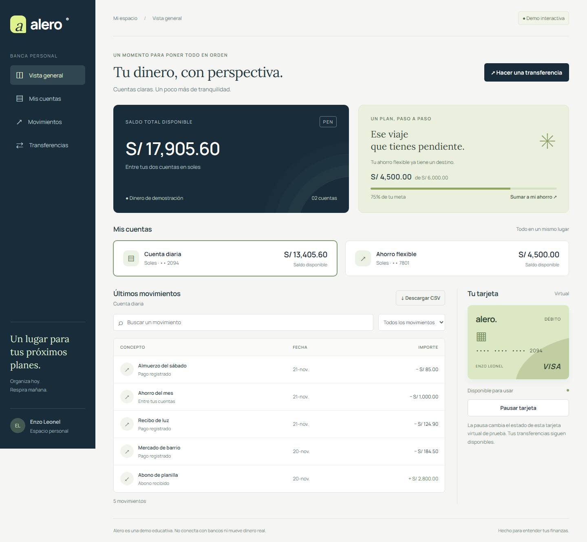

# Alero · banca personal de demostración



Alero permite consultar dos cuentas en soles, mover fondos entre ellas y registrar pagos a beneficiarios. Incluye búsqueda de movimientos, filtros de ingresos y salidas, descarga CSV, meta de ahorro y pausa de una tarjeta virtual.

Es una simulación educativa: el estado se guarda en este navegador. No tiene autenticación, servidor bancario ni conexión con entidades financieras; los datos y el dinero son de demostración. El estado local puede modificarse con las herramientas del navegador y no constituye un registro financiero confiable.

## Ejecutar

Node.js 24 y npm. Para ZAP y Nuclei también se necesita Docker con contenedores Linux.

```sh
npm ci
npm run dev
```

Abrir http://localhost:4173. No hay dependencias de ejecución ni recursos externos durante el uso. Las fuentes Manrope y Lora incluyen sus licencias OFL en `assets/fonts/`.

## Pruebas y escaneo

```sh
npm test
npx playwright install chromium
npm run test:e2e
npm run build
npm run scan
npm run scan -- --compare
```

Las pruebas utilizan `node:test` y Playwright. No se incluyen MSTest, xUnit, NUnit ni Moq. Se verifican operaciones en céntimos enteros, conservación del total entre cuentas, fondos insuficientes, identificadores duplicados, validación del estado, exportación CSV, persistencia, XSS, fallo de almacenamiento y uso móvil.

`scripts/build.mjs` limpia `dist/` y copia solo HTML, recursos y módulos. ZAP Baseline 2.17.0 realiza un análisis pasivo; Nuclei 3.11.1 ejecuta tres plantillas oficiales versionadas en `security/nuclei/`. El control comparativo agrega un `.git/config` de prueba sin credenciales y retira la CSP en una copia separada. Nunca se publica esa copia ni se escanean servicios de terceros.

El pipeline bloquea errores de ejecución, alertas ZAP altas, Nuclei alto/crítico o exposición de Git. Las demás alertas se conservan para revisión. Aprobar no implica ausencia de vulnerabilidades. [Resultados y límites](docs/security-results.md).

## Automatizaciones y ubicación

Los workflows están en `.github/workflows/` y se pueden consultar o ejecutar desde la pestaña **Actions** del repositorio.

| Automatización | Ubicación | Cuándo se ejecuta | Qué hace |
| --- | --- | --- | --- |
| Pruebas y análisis de vulnerabilidades | [`.github/workflows/quality.yml`](.github/workflows/quality.yml) | Push a `main`, pull request o ejecución manual | Instala dependencias, ejecuta las pruebas de lógica, construye la app, prueba la interfaz con Playwright y analiza el sitio local con ZAP y Nuclei. Conserva los informes de seguridad y de navegador en el artefacto `alero-quality`. |
| Publicación en GitHub Pages | [`.github/workflows/pages.yml`](.github/workflows/pages.yml) | Ejecución manual mediante **Run workflow** | Repite las pruebas, el build y los escaneos. Guarda los informes en `alero-pages-quality`, empaqueta `dist/` y, si las verificaciones aprueban, lo despliega mediante un job separado en el entorno `github-pages`. |

### Scripts de apoyo

| Script | Cómo se ejecuta | Qué hace |
| --- | --- | --- |
| [`scripts/build.mjs`](scripts/build.mjs) | `npm run build` | Limpia `dist/` y copia únicamente el HTML, los recursos y los módulos que se publicarán. Lo utilizan ambos workflows. |
| [`scripts/scan.mjs`](scripts/scan.mjs) | `npm run scan` | Inicia un servidor temporal del build, ejecuta ZAP y Nuclei en Docker, genera reportes y aplica los criterios de bloqueo. Lo utilizan ambos workflows. Con `--compare` también analiza la copia de control. |
| [`scripts/capture.mjs`](scripts/capture.mjs) | `node scripts/capture.mjs` | Genera las capturas de escritorio, móvil y formulario en `docs/images/`. Se ejecuta manualmente y necesita la app servida en `http://127.0.0.1:4180/`. |

## Publicación en GitHub Pages

El repositorio se mantiene en [Durdenxito/alero-security-lab](https://github.com/Durdenxito/alero-security-lab). Sitio publicado: https://durdenxito.github.io/alero-security-lab/.

Para publicar: **Settings → Pages → GitHub Actions**, después **Actions → Publicar Alero en GitHub Pages → Run workflow**. Sitio publicado: `https://durdenxito.github.io/alero-security-lab/`. El despliegue inicial está completado. Para publicar cambios posteriores, ejecutar de nuevo el workflow manual. Configuración basada en la [documentación oficial](https://docs.github.com/en/pages/getting-started-with-github-pages/using-custom-workflows-with-github-pages).

## Artículo

[Alero: pruebas y escaneo de una aplicación bancaria](docs/article.md), preparado para Dev.to con introducción, propósito y herramientas, desarrollo y conclusiones. No se genera video para esta versión.

## Persistencia en Pages

Los movimientos, saldos derivados y el estado de la tarjeta se conservan en `localStorage`, bajo la clave `alero.bank.v1`. Se comprobó en el sitio público que una transferencia y la pausa de tarjeta sobreviven a una recarga y al cierre y reapertura del navegador con el mismo perfil. [Resultado de la comprobación](docs/evidence/pages-persistence.json).

Los datos pertenecen a ese navegador y al origen `https://durdenxito.github.io`; se mantienen al volver a desplegar mientras se conserven el origen y la clave de almacenamiento. No se sincronizan con otros dispositivos, perfiles ni con el servidor local. Borrar los datos del sitio elimina el estado guardado.
