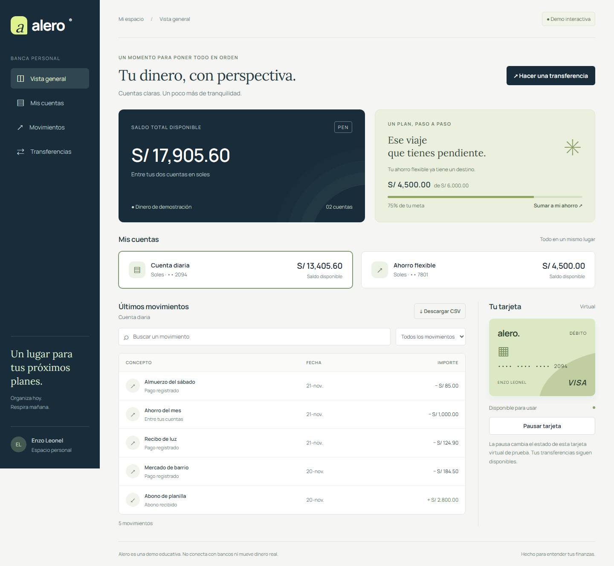

## Introducción de la aplicación

Alero es una aplicación bancaria de demostración. Tiene una cuenta diaria, una cuenta de ahorro y un historial de movimientos. Desde el panel se puede transferir dinero entre ambas cuentas, pagar a dos beneficiarios de ejemplo y descargar los movimientos como CSV. La cuenta de ahorro alimenta una meta para un viaje; la tarjeta virtual se puede pausar y reactivar.

El [repositorio público](https://github.com/Durdenxito/alero-security-lab) contiene la aplicación y su automatización. Está hecha con HTML, CSS y módulos JavaScript. El navegador conserva el estado en `localStorage`, por lo que las operaciones pertenecen a ese dispositivo. No hay una entidad financiera detrás ni se mueve dinero real. Este alcance permite estudiar el formulario, los cálculos y el empaquetado sin introducir credenciales bancarias.



## Propósito de la prueba y herramientas utilizadas

La revisión busca responder dos preguntas: ¿puede una operación dejar un saldo incorrecto?, y ¿qué problemas detectan los escáneres en el paquete que se publicaría? Son preguntas diferentes. Un escáner HTTP puede advertir una cabecera ausente, pero no sabe si una transferencia interna conservó el total entre las cuentas.

Para el comportamiento se utiliza `node:test`, incluido en Node.js, y Playwright para las interacciones del navegador. Las pruebas no dependen de MSTest, xUnit, NUnit ni Moq. Para el análisis de vulnerabilidades se mantienen ZAP y Nuclei, herramientas incluidas en el [listado de OWASP](https://community.owasp.org/Vulnerability_Scanning_Tools).

ZAP Baseline 2.17.0 recorre el servidor local durante un minuto y analiza las respuestas con reglas pasivas. No ejecuta ataques activos. Sus informes HTML y JSON permiten revisar el contexto de las advertencias. Esa es la modalidad descrita en la [documentación del baseline](https://www.zaproxy.org/docs/docker/baseline-scan/).

Nuclei 3.11.1 ejecuta tres plantillas oficiales: exposición de `.git/config`, listado de directorios y cabeceras de seguridad. Las plantillas se incluyen sin modificar y con su commit de procedencia. El script limita el ritmo a cinco peticiones por segundo y desactiva Interactsh. La selección explícita de plantillas está documentada por [ProjectDiscovery](https://docs.projectdiscovery.io/opensource/nuclei/running).

## Desarrollo

El cálculo de importes fue el primer punto de revisión. JavaScript representa los números decimales mediante coma flotante, de modo que no conviene encadenar operaciones con importes como `0.10`. Alero convierte el texto del formulario a céntimos enteros: `12.34` se almacena como `1234`. El parser admite punto o coma decimal y rechaza cantidades negativas, cero, notación exponencial y más de dos decimales.

Una transferencia genera un único movimiento con origen, destino e importe. Los saldos se calculan a partir de ese historial. Antes de crear el movimiento se comprueba que las cuentas sean diferentes, que el destino exista y que haya fondos. El identificador de la solicitud impide registrarla dos veces. La persistencia ocurre antes de sustituir el estado de la pantalla: si el navegador rechaza la escritura, no se aplica el débito.

Las pruebas verifican estas condiciones con cantidades concretas. Una transferencia de S/ 0.10 debe restar diez céntimos de una cuenta y sumarlos a la otra, sin cambiar el total. Un pago a un beneficiario reduce el total disponible. Una solicitud de S/ 1,000,000 sin fondos debe dejar el historial intacto. Otra prueba provoca un error de almacenamiento y comprueba que el saldo de ahorro siga siendo S/ 4,500.00.

El concepto de una transferencia también es una entrada de usuario. La vista lo inserta mediante `textContent`. Playwright envía un concepto que contiene un elemento `img` con `onerror`; después comprueba que el texto sea visible, que no se cree una imagen y que no se ejecute el indicador de prueba. El CSV escapa comillas y antepone un apóstrofo cuando una celda podría interpretarse como fórmula.

El empaquetado se revisa por separado. El build elimina el directorio de salida y copia únicamente `index.html`, `assets/` y `src/`. Una prueba introduce un `.git/config` residual y confirma que desaparece al reconstruir. Los archivos del repositorio, los tests y las evidencias no forman parte del sitio.

Para ejecutar la revisión local:

```sh
npm ci
npm test
npx playwright install chromium
npm run test:e2e
npm run build
npm run scan -- --compare
```

La comparación analiza dos copias propias. El control retira la CSP del HTML e incluye un `.git/config` mínimo sin credenciales. La otra copia sirve el artefacto final. Es un experimento controlado de empaquetado; no representa un incidente ocurrido en un banco. Los resultados de esta versión se conservan en el [informe y sus resúmenes originales](https://github.com/Durdenxito/alero-security-lab/blob/main/docs/security-results.md).

En la ejecución del 22 de noviembre de 2026 aprobaron siete pruebas de lógica y empaquetado y seis de navegador. ZAP informó nueve grupos de alertas en cada variante, sin alertas altas. Nuclei pasó de diez coincidencias en el control a nueve en el final: dejó de detectar el archivo de Git. Las nueve coincidencias restantes son avisos informativos de cabeceras. El número de alertas ZAP no bajó porque el aviso de CSP ausente fue sustituido por otro sobre una directiva sin fallback.

La CSP del HTML restringe los recursos al mismo origen y bloquea conexiones de red. Su alcance tiene un límite concreto: la protección `frame-ancestors` requiere una cabecera HTTP y no funciona desde un `<meta>`. Por eso el aviso de framing debe revisarse como hallazgo pendiente. Nuclei busca la cabecera CSP y puede seguir avisando aunque ZAP reconozca la política del HTML. Tampoco corresponde atribuir a Pages las cabeceras del servidor HTTP usado en las pruebas locales.

GitHub Actions ejecuta pruebas, build, Playwright y escáneres con cada cambio. El control de calidad falla si un motor no termina correctamente, si ZAP encuentra una alerta alta, si Nuclei detecta severidad alta o crítica, o si se expone Git. Los demás avisos permanecen en los reportes. El workflow de Pages repite los controles y publica `dist/` en un job separado con los permisos necesarios, siguiendo la [documentación de GitHub](https://docs.github.com/en/pages/getting-started-with-github-pages/using-custom-workflows-with-github-pages). Su ejecución es manual. La [aplicación publicada en GitHub Pages](https://durdenxito.github.io/alero-security-lab/) conserva el estado en el navegador. Una comprobación sobre el sitio público confirmó que una transferencia y la pausa de tarjeta permanecen después de recargar y reiniciar el navegador con el mismo perfil. Esta persistencia no sincroniza datos entre dispositivos.

## Conclusiones

El modelo de movimientos permite comprobar los saldos sin mantener dos cifras independientes que podrían quedar desactualizadas. Las pruebas cubren los rechazos y los fallos de persistencia, además de una operación correcta. El escaneo complementa esa revisión al inspeccionar lo que responde el servidor y detectar archivos que no deberían publicarse.

La aplicación conserva límites propios de una demo: cualquiera con acceso al navegador puede modificar el estado local. Las pruebas realizadas no evalúan autenticación, autorización entre clientes ni un backend transaccional, porque esos componentes no existen aquí. Una banca real necesitaría resolverlos en el servidor. En esta versión, la evidencia útil es reproducible y acotada: reglas de transferencia comprobadas, contenido hostil tratado como texto y reportes que conservan las advertencias pendientes antes de habilitar Pages.
